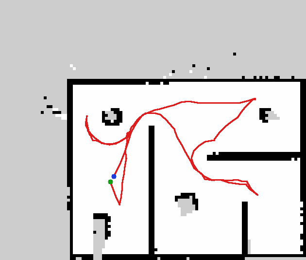

# HB bot: autonomous lidar exploration with a holonomic robot

A complete ROS 2 workshop project. A 3-wheel omni (kiwi) drive robot with a 2D
lidar maps an unknown area **by itself**, first in Gazebo, then for real on a
Raspberry Pi + ESP32.

```
 2D lidar ─► SLAM (slam_toolbox) ─► map ─► frontier explorer ─► Nav2 ─► cmd_vel
                                                                         │
                              kiwi_drive (kinematics + odometry) ◄───────┘
                                 │                     ▲
                       wheel speeds (rad/s)     wheel feedback
                                 ▼                     │
                 Gazebo + ros2_control   OR   ESP32 (PID) via esp32_bridge
```

**Stack:** ROS 2 Jazzy · Gazebo Harmonic · Ubuntu 24.04 · slam_toolbox · Nav2 ·
Raspberry Pi 4/5 · ESP32 (Arduino).

## Repository layout

```
Athena/
├── hb_bot.urdf                  original model (kept for reference)
├── ros2_ws/src/
│   ├── hb_description/          URDF/xacro: robot + omni wheels + lidar mount
│   ├── hb_gazebo/               arena world, Gazebo launch, ROS<->Gazebo bridge
│   ├── hb_control/              kiwi kinematics, odometry, ESP32 serial bridge
│   ├── hb_navigation/           SLAM + Nav2 configs, frontier explorer
│   └── hb_bringup/              one-command launches (sim and real robot)
├── firmware/esp32_kiwi_base/    ESP32 motor controller (Arduino / PlatformIO)
├── aiml_modules/                the AI/ML behind the robot: 7 runnable Python modules (any OS, no ROS)
├── docs/workshop.md             workshop plan, module by module
├── docs/hardware.md             parts, wiring, calibration, Raspberry Pi setup
└── docker/                      Jazzy + Gazebo image and the headless test scripts
```

## Quick start (simulation)

On Ubuntu 24.04 with ROS 2 Jazzy installed:

```bash
sudo apt install ros-jazzy-ros-gz ros-jazzy-gz-ros2-control ros-jazzy-ros2-controllers \
  ros-jazzy-slam-toolbox ros-jazzy-navigation2 ros-jazzy-xacro \
  ros-jazzy-joint-state-publisher-gui ros-jazzy-teleop-twist-keyboard ros-jazzy-rplidar-ros
cd ~/Athena/ros2_ws
colcon build --symlink-install
source install/setup.bash

ros2 launch hb_bringup sim_autonomy.launch.py
```

Gazebo and RViz open. After about 15 s the robot starts exploring on its own.
In RViz, cyan dots are frontiers, orange balls are candidate goals, the green
ball is the current goal, and red balls are spots it has already tried. When
nothing is left to explore it drives back to the start.



*A real headless run: the map slam_toolbox built, with the robot's ground-truth
path in red, from the start (green) to home (blue). It covered all three rooms
in about 3 simulated minutes and 11 frontier goals.*

Save the map:

```bash
ros2 run nav2_map_server map_saver_cli -f ~/maps/arena
```

### Step by step (what the workshop does)

```bash
ros2 launch hb_description display.launch.py          # 1. the model in RViz
ros2 launch hb_gazebo sim.launch.py rviz:=true        # 2. simulation
ros2 run teleop_twist_keyboard teleop_twist_keyboard  #    drive it (Shift = strafe)
ros2 launch hb_navigation slam.launch.py use_sim_time:=true        # 3. mapping
ros2 launch hb_navigation navigation.launch.py use_sim_time:=true  # 4. Nav2, click goals
ros2 launch hb_navigation explore.launch.py use_sim_time:=true     # 5. autonomy
```

## Real robot

Build and calibrate the hardware first: [docs/hardware.md](docs/hardware.md).

```bash
# Raspberry Pi
ros2 launch hb_bringup robot_autonomy.launch.py esp32_port:=/dev/ttyUSB0 lidar_port:=/dev/ttyUSB1
# Laptop (same ROS_DOMAIN_ID)
ros2 launch hb_bringup rviz.launch.py
```

## Design choices

* **One kinematics node for sim and hardware.** `kiwi_drive` turns `/cmd_vel`
  into wheel speeds and wheel feedback into `/odom`. Gazebo (ros2_control) and
  the ESP32 bridge both offer the same two topics underneath it.
* **The ESP32 only does real-time work:** encoders, per-wheel PID, a watchdog.
  All maths and ROS run on the Pi, and the serial protocol is plain text you
  can type by hand.
* **Nav2 controller: MPPI with the `Omni` motion model.** It's Nav2's default
  in Jazzy and handles strafing well. A holonomic DWB setup was tried first
  and dithered at low speed in doorways, so it was replaced.
* **A small frontier explorer written for teaching** (`frontier_search.py` is
  pure numpy and unit-tested) instead of a third-party package.
* **Only the Nav2 servers this robot needs** are launched. This is lighter on
  the Pi, and nothing waits on unconfigured servers (docking, etc.).

## What changed from the original URDF

* Split into xacro macros (`omni_wheel`, `lidar`, ros2_control, Gazebo) with
  every dimension as a named property at the top of `hb_bot.urdf.xacro`.
* **2D lidar added** on a deck with standoffs (`lidar_mount_link` → `lidar_link`),
  with a Gazebo `gpu_lidar` sensor: 360 samples, 10 Hz, 0.12–8 m, RPLidar A1/C1-like.
* **REP-103 frames.** The original model's front was +y. Now `base_link` has
  +x forward, with wheels at 60° (left), −60° (right), 180° (back).
  `base_footprint` sits on the ground, which is what Nav2 and SLAM expect.
* Absolute `file:///home/...` mesh paths replaced by `package://` paths, and
  meshes made optional (`use_meshes:=true`). Simple shapes are used by default
  and always for collisions, which keeps the roller physics stable.
* `sim_mode:=false` builds the real-robot model: no Gazebo plugins, rollers fixed.
* Passive roller joints added to ros2_control as state-only, so RViz shows the
  whole robot.

## Testing

```bash
colcon test --packages-select hb_control hb_navigation && colcon test-result --verbose
```

Docker (also works on Windows/macOS). Run from the repo root:

```bash
docker build -t hb_bot:jazzy docker
# build, URDF checks, wheel-geometry check, unit tests, launch files
docker run --rm -v "$PWD/ros2_ws/src:/ros2_ws/src:ro" -v "$PWD/docker:/scripts:ro" hb_bot:jazzy bash /scripts/validate.sh
# headless Gazebo: controllers, lidar, odometry vs ground truth
docker run --rm -v "$PWD/ros2_ws/src:/ros2_ws/src:ro" -v "$PWD/docker:/scripts:ro" -v "$PWD/docker/out:/out" hb_bot:jazzy bash /scripts/sim_test.sh
# full autonomy run, headless; final map in docker/out/map_final.pgm
docker run --rm -v "$PWD/ros2_ws/src:/ros2_ws/src:ro" -v "$PWD/docker:/scripts:ro" -v "$PWD/docker/out:/out" hb_bot:jazzy bash /scripts/autonomy_test.sh
```

ESP32 firmware compile check: `cd firmware && pio run`.
